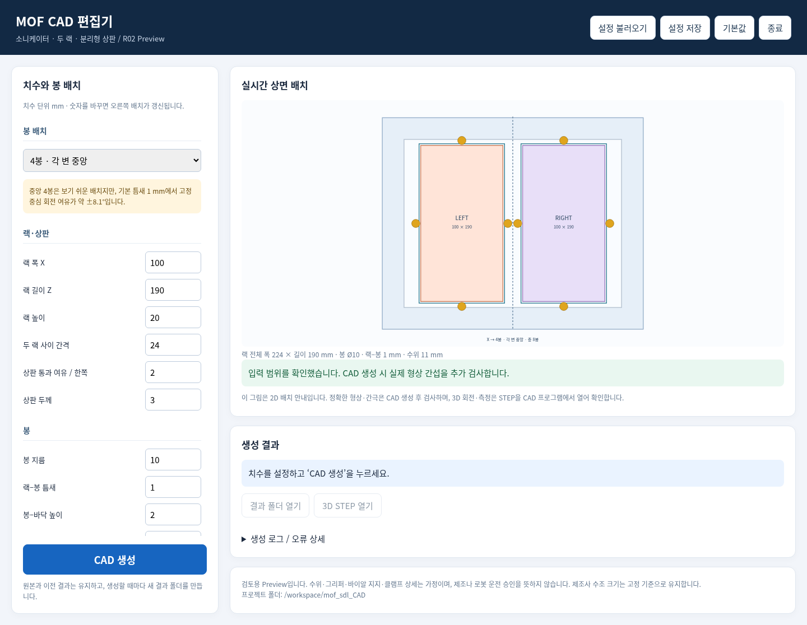
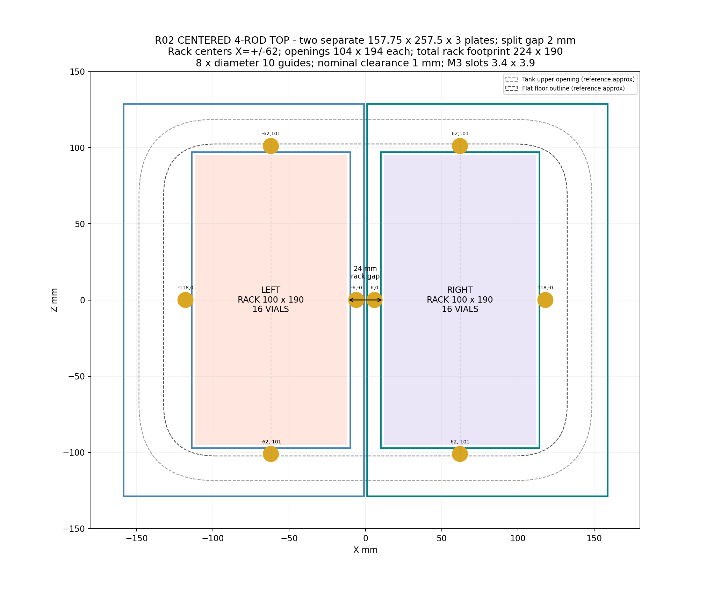
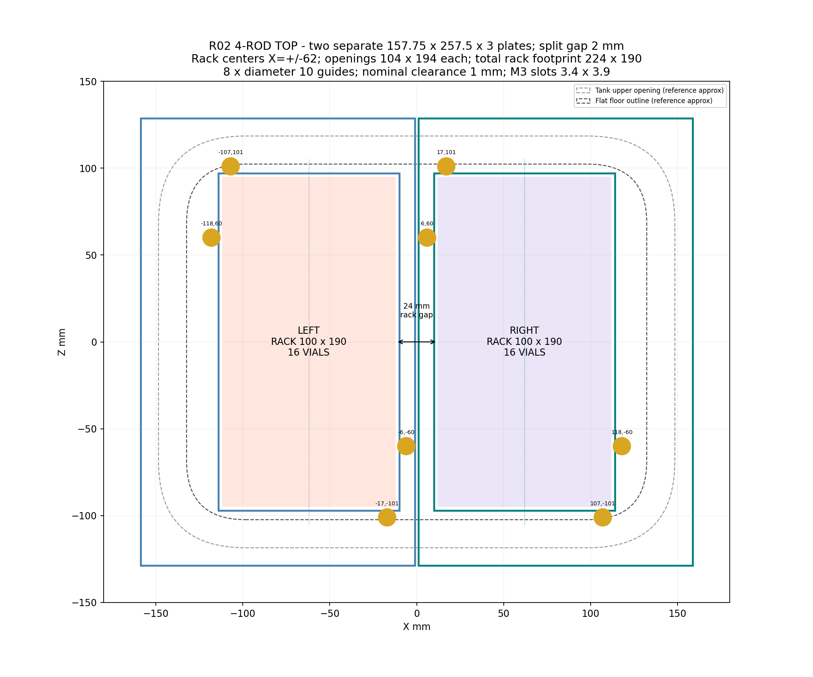
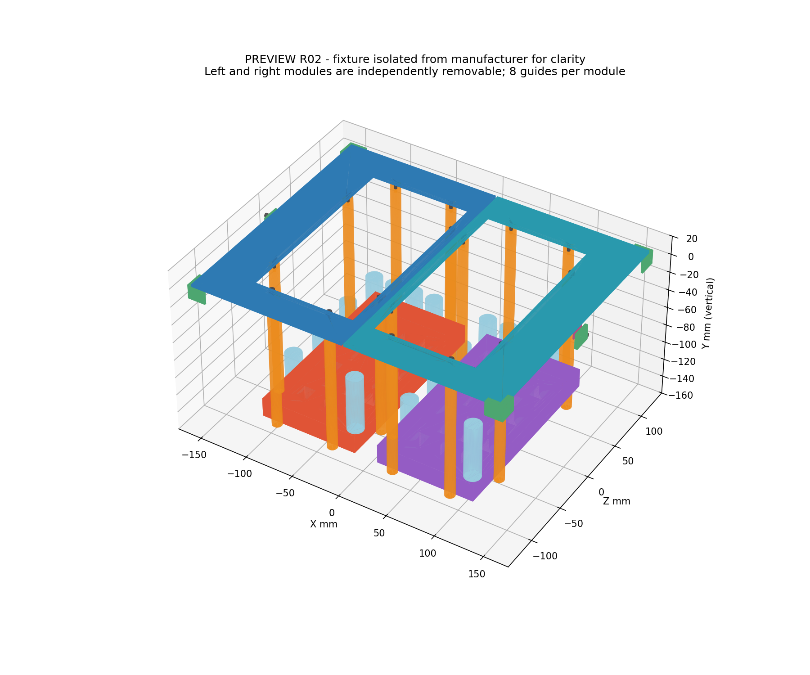
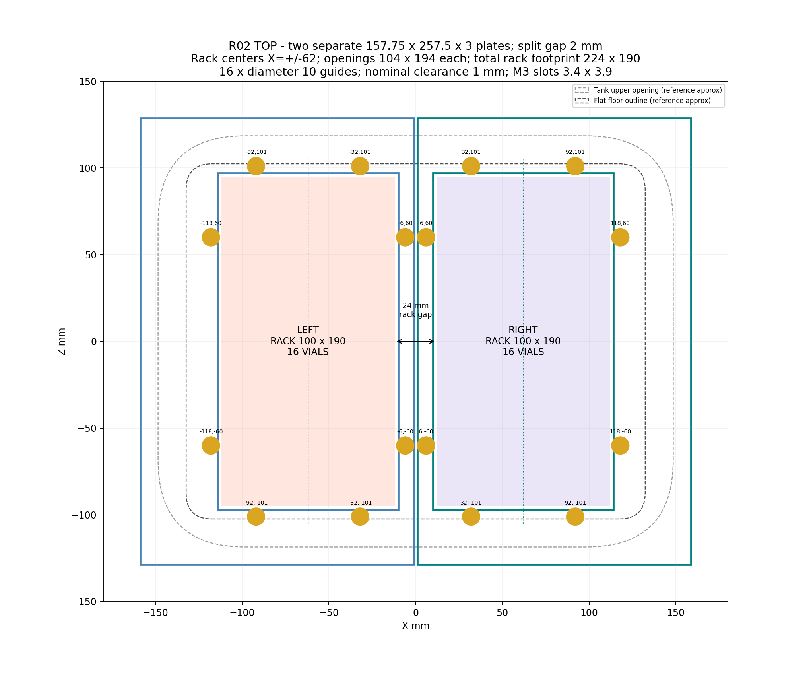

# MOF CAD 편집기 — 입력칸과 CAD 생성 버튼

**코드를 고치지 않고 치수와 봉 배치를 바꾸는 Windows용 편집기입니다.**

👉 **[편집기 포함 전체 ZIP 다운로드](https://github.com/hm428755/mof_sdl_CAD/raw/refs/heads/main/Downloads/MOF_CAD_Editor_R02_Windows.zip)**

1. `C:\Users\yeonseo kim\Desktop\MOF_SDL\Hardware\CAD`에 압축을 풉니다.
2. Python3.12가 설치된 상태에서 **`06_Open_CAD_Editor_R02.bat` 더블클릭**.
3. 입력칸/배치를 변경 → **CAD 생성** → **3D STEP 열기**.

처음에는 필요한 Python 패키지를 설치합니다. 이후 같은 PC에서 코드 수정이나 새 ZIP 없이 계속 생성할 수 있습니다. 생성마다 새 결과 폴더를 만들어 이전 안을 보존합니다.

- 실시간2D배치, 중앙4봉/엇갈린4봉/8봉 선택
- 랙·봉·상판·수위·바이알 입력과 잘못된 치수 조합 차단
- 설정 저장/불러오기, 이전 생성 설정 재사용
- STEP·PNG 생성 및 실제 형상 검사, 로그/오류 표시
- Windows CAD 프로그램으로 STEP 열기

[설치·사용 안내](07_CAD_Editor_README_R02.md)



실시간 미리보기는2D이고, 생성 후3D정지이미지도 표시합니다. 3D회전/측정은STEP을CAD프로그램에서진행합니다. Windows자체실행은미검증이며LinuxChromium에서브라우저/실제CAD생성을검증했습니다. 제조/로봇운전승인도구가아니며수위/그리퍼/클램프상세는미확정입니다.

---

## 이전 CAD 비교안

# 최신 R02 — 각 변 중앙에 봉 1개씩

사용자가 요청한 중앙4봉안을 별도 family로 추가했습니다. 랙2개/상판2분할 유지, 랙당4봉/총8봉입니다.

- [중앙4봉 Windows ZIP 다운로드](https://github.com/hm428755/mof_sdl_CAD/raw/refs/heads/main/Downloads/Sonicator_R02_Centered4_Windows.zip)
- [중앙4봉 조립 STEP](Modules/01_Sonicator_Rack_Guide/03_Preview/04_Rack_Guide_Centered4_R02/01_Sonicator_Two_Racks_Split_Top_Preview_R02_Centered4.step)



| R02 비교안 | 배치 | 랙당 봉 | 고정중심 회전 첫접촉 |
|---|---|---:|---|
| 원래8봉 | 장변/단변 각2개 |8|약±0.948°|
| 엇갈린4봉 | 각변 중앙에서엇갈림 |4|약−1.243°/+0.948°|
| 최신중앙4봉 | 각변정중앙 |4|약±8.069°|

각도는 단순형상계산이며 실제운전/공차/진동검증이아닙니다. 중앙4봉은회전여유가커서정밀한반복로봇픽업을보장하지않습니다. 이전안은덮어쓰지않고보존했습니다.

Windows 새경로와실행:04_Windows_CAD_README_R02.md참고. 중앙안은05_Build_CAD_Centered4_R02.bat,이전엇갈린안은03_Build_CAD_Windows_R02.bat로생성합니다. 검토용Preview이며클램프/실제그리퍼/수위상세미확정입니다.

---

# 최신 R02 — 랙당 4봉 변형안

랙2개/독립상판2개를 유지하고 랙당 가이드봉4개(총8개)로 줄였습니다. 네변에서 엇갈리게 배치했습니다. 기존8봉/랙 R02는 아래와 기존폴더에 보존합니다.

새PC프로젝트폴더: `C:\Users\yeonseo kim\Desktop\MOF_SDL\Hardware\CAD`

[Windows 설치·실행 안내](04_Windows_CAD_README_R02.md)

[4봉 변형안 조립 STEP](Modules/01_Sonicator_Rack_Guide/03_Preview/03_Rack_Guide_4Rod_R02/01_Sonicator_Two_Racks_Split_Top_Preview_R02_4Rod.step)



검토용 Preview입니다. 수위·실제그리퍼·클램프상세는 미확정이며, 로봇운전/제작승인본이아닙니다.

---

# MOF SDL CAD — 소니케이터 랙 가이드

**Preview R02: 랙 2개 동시 수용 · 독립 상판 2개**

## 다운로드

- **[전체 ZIP 다운로드](https://github.com/hm428755/mof_sdl_CAD/raw/refs/heads/main/Downloads/Sonicator_Rack_Guide_Preview_R02.zip)** — STEP, CadQuery 소스, 파라미터, 미리보기와 검증 기록
- [제조사 포함 조립 STEP](https://github.com/hm428755/mof_sdl_CAD/raw/refs/heads/main/Downloads/Sonicator_Two_Racks_R02.step)
- [좌측 가이드 모듈 STEP](https://github.com/hm428755/mof_sdl_CAD/raw/refs/heads/main/Downloads/Left_Guide_R02.step)
- [우측 가이드 모듈 STEP](https://github.com/hm428755/mof_sdl_CAD/raw/refs/heads/main/Downloads/Right_Guide_R02.step)

GitHub 파일 화면을 열었다면 **Download raw file** 버튼으로 받을 수 있습니다. 위 주소는 채팅 아티팩트가 아닌 GitHub 파일 다운로드 주소입니다.





## R02 설계

- 랙 각각190 ×100 ×20 mm, 16바이알; 최대2랙/32바이알
- R01 대비90° 회전하여 나란히 배치: 전체224 ×190 mm, 랙간24 mm
- 상판2개, 각각157.75 ×257.5 ×3 mm, 상판간2 mm
- 각프레임8개/총16개 Ø10 가이드 봉, 랙–봉틈새1 mm, 바닥위2 mm
- 제조사좌표계 X/수직Y/Z, 단위mm

실제 솔리드 유효성과 STEP 재가져오기, 랙/가이드/수조 표면 간극을 검사했습니다. 제조사 STEP 원본은 솔리드가 아닌 surface-shell reference이며 수정하지 않았습니다. 개별 모듈 STEP에는 제조사·랙·바이알 참고형상을 제외했습니다.

**검토용 Preview이며 제조·로봇운전 승인본이 아닙니다.** 수위·그리퍼·바이알 지지·클램프 유지력·테이블 체결 상세는 미확정입니다. 원래 CAD 프로젝트의 revision router는 제공되지 않아 해당 prepare/check는 실행하지 못했습니다. R01은 원래 작업공간에 보존되어 있고 이 저장소에는 R02를 전달합니다.

## 수정과 재생성

- [CadQuery 소스](Modules/01_Sonicator_Rack_Guide/02_Work/02_Rack_Guide_R02/01_build_Preview_R02.py)
- [parameters.py](Modules/01_Sonicator_Rack_Guide/02_Work/02_Rack_Guide_R02/parameters.py)
- [설계 근거](Modules/01_Sonicator_Rack_Guide/03_Preview/02_Rack_Guide_R02/09_design_basis.md)
- [검증 기록](Modules/01_Sonicator_Rack_Guide/03_Preview/02_Rack_Guide_R02/11_verification.txt)

CadQuery, NumPy, Matplotlib이 설치된 Python에서 저장소 루트 기준:

```bash
python3 Modules/01_Sonicator_Rack_Guide/02_Work/02_Rack_Guide_R02/01_build_Preview_R02.py
```

이 명령은 R02 Preview를 재생성합니다. 변경안을 제작 승인본으로 덮어쓰지 말고 새 revision으로 보존하십시오. 첨부 원본 지시서의1랙배치보다 이후 사용자 요구인2랙/2분할상판을 우선했습니다. 입력문서는01_References에 원본으로 보존했습니다.
